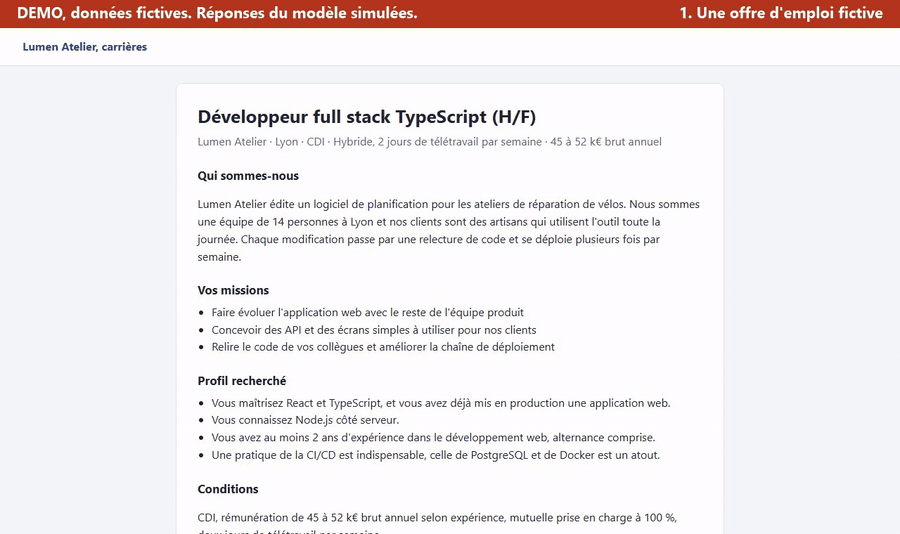

# apply4me

[English version](README.md)

apply4me est une extension de navigateur pour les personnes qui cherchent un emploi. Un clic sur la page d'une offre indique si l'offre vaut la peine d'être tentée. L'extension prépare ensuite un CV d'une page adapté à l'offre, une lettre de motivation sur mesure et une fiche de révision pour l'entretien quand vous en avez besoin. Tout reste dans votre navigateur. Il n'y a ni serveur ni compte, et vous fournissez votre propre clé d'API.

## Fonctionnalités

- L'extension lit l'offre de la page ouverte et la compare à vos compétences. Le code calcule le verdict, et le modèle se contente d'extraire ce que l'offre demande.
- Le popup montre les exigences que vous couvrez et celles qui manquent. Vous pouvez cocher des outils manquants pour les ajouter à la ligne de compétences de votre CV.
- Le CV vient d'une base de faits que vous relisez. Le modèle choisit et reformule ces faits, sans jamais en créer. Le code contrôle ensuite les chiffres, les outils et le niveau de responsabilité.
- La lettre de motivation s'écrit en français ou en anglais et passe par les mêmes contrôles.
- L'onglet de travail prépare aussi les questions probables d'entretien, un court message au recruteur et une fiche de révision pour les compétences ajoutées.
- Vous pouvez télécharger le CV et la lettre en PDF, copier le texte ou insérer la lettre dans le champ du formulaire de l'offre.
- Un journal conserve chaque candidature avec son statut et s'exporte en CSV.
- L'interface est en français.

## Démonstration



L'enregistrement utilise une offre et un profil fictifs, rangés dans [demo](demo). Les réponses du modèle sont simulées pour que rien ne sorte de la machine. Vous pouvez aussi regarder la [version MP4](docs/media/demo.mp4).

## Installation

Il faut Node.js avec npm. Le build a été vérifié avec Node.js 21.

1. Clonez le dépôt et installez les dépendances.

   ```bash
   git clone https://github.com/MehdiZen/apply4me.git
   cd apply4me
   npm install
   ```

2. Construisez l'extension pour Chrome, Edge ou Brave.

   ```bash
   npm run build:chrome
   ```

3. Ouvrez `chrome://extensions` et activez le mode développeur.
4. Cliquez sur "Charger l'extension non empaquetée" et choisissez le dossier `dist` du dépôt.

Cliquez sur le bouton de rechargement de la carte de l'extension après un nouveau build. Vos données sont conservées.

Firefox demande `npm run build` à la place. Chargez `dist/manifest.json` comme module temporaire depuis `about:debugging`. Le build Firefox ne demande pas la permission `debugger`, donc l'export PDF ouvre la boîte d'impression.

## Configuration

Ouvrez les réglages avec la roue dentée du popup, ou depuis la page d'options de l'extension. La mise en route compte trois étapes.

1. Connectez votre clé d'API et choisissez un modèle. La page de réglages liste les deux fournisseurs pris en charge.
2. Importez votre CV en PDF ou en image. L'extension construit votre base de faits et vous la relisez.
3. Renseignez votre profil et vos règles de recherche.

Vous pouvez aussi importer un fichier de profil exporté plus tôt depuis la même page.

La clé d'API est stockée dans le stockage local de votre navigateur et n'est envoyée qu'au fournisseur que vous avez choisi. Le fichier de profil ne la contient jamais. Les documents générés vivent dans le stockage de session et disparaissent à la fermeture du navigateur.

L'ajout de compétences manquantes au CV est désactivé par défaut. Vous pouvez l'activer dans les réglages.

Le build lit deux variables d'environnement dans le shell. Le projet n'utilise pas de fichier `.env`.

| Variable | Rôle |
| --- | --- |
| `TARGET_BROWSER` | Choisit `chrome` ou `firefox`. La valeur par défaut est `firefox`. |
| `A4M_SEED` | Chemin d'un fichier de profil qu'un build personnel embarque et charge au premier lancement. |

### Permissions

L'extension demande `storage`, `activeTab` et l'accès aux pages http et https. Le build Chrome demande aussi `debugger`, qui sert uniquement à imprimer le CV et la lettre en PDF. Le content script s'exécute sur les pages http et https pour lire l'offre et ne fait aucun appel réseau.

## Développement

| Script | Rôle |
| --- | --- |
| `npm run build` | Construit la version Firefox dans `dist`. |
| `npm run build:chrome` | Construit la version Chrome dans `dist`. |
| `npm run dev` | Lance la commande de développement de Vite. |
| `npm run dev:firefox` | Lance l'extension dans Firefox avec web-ext. |
| `npm test` | Lance les tests unitaires avec Vitest. |
| `npm run typecheck` | Lance le compilateur TypeScript sans produire de fichiers. |
| `npm run build:me` | Fait un build personnel avec un profil de `seed/`, puis le copie dans un dossier Windows fixe. Il convient à la machine du mainteneur et demande des adaptations ailleurs. |

Le projet n'a pas de script de lint. Les tests utilisent deux profils fictifs, un développeur et une infirmière.

Construisez avec `TARGET_BROWSER=chrome A4M_SEED=demo/profil-fictif.json npx vite build` pour enregistrer la démonstration de nouveau, puis suivez l'en-tête de [demo/record.mjs](demo/record.mjs). Le script charge Playwright et ffmpeg-static depuis un dossier situé hors du dépôt.

## Structure du dépôt

| Chemin | Contenu |
| --- | --- |
| `extension/content` | Content script qui lit l'offre et remplit le champ de la lettre. |
| `extension/lib` | Analyse de l'offre, rapprochement, génération du CV et de la lettre, contrôles, stockage et export PDF. |
| `extension/popup` | Popup avec le verdict et les compétences à ajouter. |
| `extension/workspace` | Onglet où se génèrent le CV, la lettre et la fiche de révision. |
| `extension/options` | Page de réglages pour la clé, le CV, la base de faits, le profil et le journal. |
| `extension/ui` | Thème et composants partagés. |
| `extension/types` | Types TypeScript partagés. |
| `tests` | Tests unitaires et jeux de données fictifs. |
| `demo` | Profil fictif, offre fictive et script d'enregistrement. |
| `docs/media` | Vidéo et GIF de démonstration. |
| `icons` | Icônes de l'extension. |
| `manifest.json` | Manifeste de l'extension. |

## Licence

<!-- LICENSE-PENDING -->
